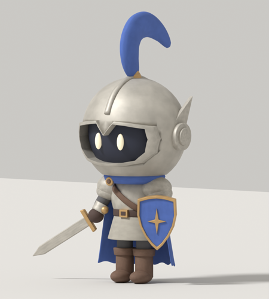

# Knight Companion

A tiny 3D knight who lives on your Android screen. He patrols the status bar (past the clock, date and battery) or wanders around the whole screen, stops to look around, and sometimes raises his sword.

- **Tap him** and he cheers with his sword raised.
- **Hold him** for the quick menu: focus timer and reminders.
- **Drag him** anywhere. In status-bar mode he hops back up onto the bar when you let go.

### His jobs
- **⏰ Focus timer & reminders.** Focus for 25/50 min (he wears a countdown pill), a 5-min break, or "remind me to… in 5/15/30/60 min or at a time". When it's due he raises his sword with a speech bubble *and* you get a ringing notification, so it works with the screen off too. Reminders survive reboots.
- **📜 Herald.** When a message arrives he runs to the middle of the screen holding a scroll with the app, sender and a preview. Tap the scroll to open it. Silent/low-priority notifications, media, calls and progress bars are ignored. You can hide message text. Needs *notification access*, and nothing leaves the phone.
- **💧 Break nudges.** After 30 min (adjustable) of continuous screen time he suggests water, a stretch, resting your eyes or a short walk. A minute with the screen off resets the count.

He's drawn from frames pre-rendered from the Blender model in the companion project (`knight/sprites_knight.py`), so he looks exactly like the renders and costs almost no battery.

- **Target device:** Nothing Phone 3a (Nothing OS / Android 15)
- **minSdk 26 · targetSdk 35** · Kotlin, no third-party libraries

> **No Android Studio needed.** Every push builds on GitHub Actions and attaches an installable APK to [Releases](../../releases).

---

## 📲 Install on your phone

1. On the phone, open the **[latest release](../../releases/latest)** and tap **`knight-companion-latest.apk`** under **Assets**.
2. Open the downloaded file. If Android says installing from your browser is blocked, tap **Settings**, turn on **Allow from this source**, go back and tap **Install**.
3. Open **Knight Companion** and tap **Allow permission**. Find **Knight Companion** in the list and turn on **Display over other apps**.
   - **If it says "access denied" or the toggle is greyed out:** Android locks this permission for apps installed from a downloaded APK ("restricted settings"). Go to **Settings → Apps → Knight Companion**, tap **⋮** (top right) → **Allow restricted settings**, confirm with your PIN or fingerprint, then turn the toggle on. The ⋮ option only appears after you've tried the toggle once.
4. Go back and tap **Start patrol**. Allow notifications if asked. The notification is how Android keeps him running, and it has a **Send him home** button.

Every build is signed with the same key (`app/companion-debug.p12`), so **a new APK installs over the old one** and keeps your settings.

### Turning on the herald
In the app, tick **Herald** and turn on **Knight Companion** under notification access. If Android says access is restricted, it's the same fix as above (**⋮ → Allow restricted settings** in App info).

### If he disappears after a while
Nothing OS can close background apps to save battery. Go to **Settings → Apps → Knight Companion → Battery** and choose **Unrestricted**.

### Why he walks *behind* the status bar icons
Android draws app overlays under the system status bar, so the clock and battery icons stay on top of him and he walks between them. When you pull down the notification shade, it covers him.

---

## 🔨 How it works

- `CompanionService` is a foreground service that adds a small overlay window (`TYPE_APPLICATION_OVERLAY`) the size of the sprite and moves it every frame with `Choreographer`. Because the window is only as big as the knight, touches everywhere else go to your apps as normal.
- The knight's behaviour is a small state machine: **walk → idle / cheer → walk**, plus **drag** and **hop** (springing back onto the bar).
- The walk cycle advances by distance travelled, so his feet don't slide at any speed.
- `assets/knight/` holds the frames (12 walk, 12 idle, 24 cheer) and `meta.json` with the frame size, frames per second and foot line.

### Building
[`.github/workflows/build.yml`](.github/workflows/build.yml) runs on every push to `main`: build and lint run in parallel, and if both pass, the APK replaces the `latest` release.
